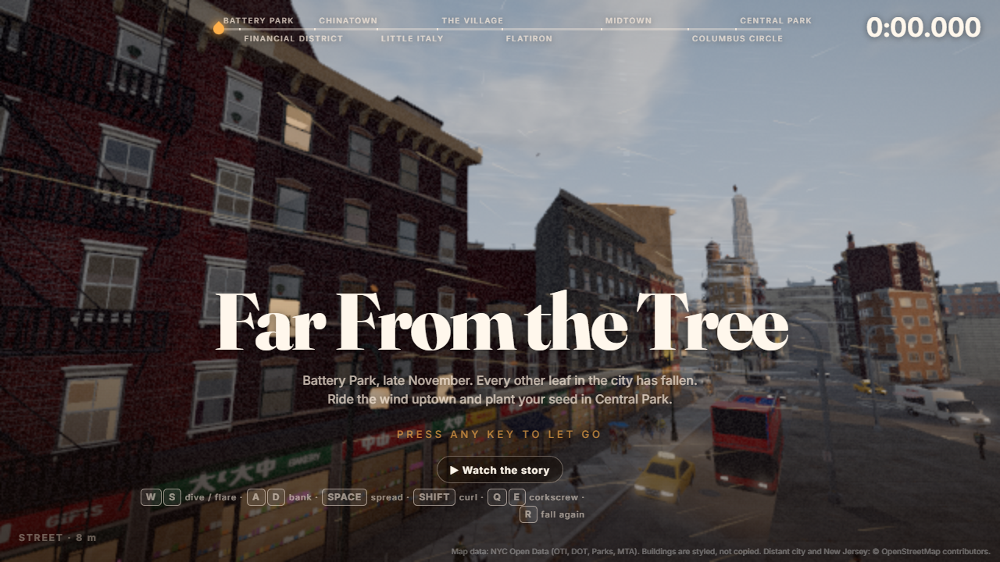

# Far From the Tree

**Play it: [farfromthetree.world](https://farfromthetree.world)**



Battery Park, late November. Every other leaf in the city has fallen. You're the last one: let go,
ride the wind uptown through Manhattan and plant your seed in Central Park.

A speedrun-flavoured leaf-flight game in the browser (three.js + TypeScript), built on real New York
open data: the real streets, buildings, subway line, stations and entrances along an 8.8 km route.
It runs on PC and phones (touch controls), with a global leaderboard.

## How it plays

- **Three layers.** The rooftops are slow and safe, the street is in the middle (cabs, people,
  pets, parked cars), and the subway is the fastest and deadliest (trains, rats).
- **A few set ways through.** Only a handful of routes really carry you uptown: **the Rooftops**,
  **the West Side** and **the East Side** (street level, along the avenues), and **the subway**.
  - Hidden currents run along them: fast cores you fly like a tailwind, with ragged edges that throw
    you out, so riding one is work.
  - Wander off a way and the city's air turns across you or quartering back.
  - **False leads** peel off the ways: currents that look just as good but run back downtown, out
    toward the river, or up blind streets.
- **Crosswinds.** At junctions the side streets throw bursts of wind across the avenue (a few seconds
  on, then calm) that shove you off your line toward the side street, harder the further uptown you
  get. Fly against them.
- **Street closures** shut the street layer and send you over the roofs, under through the subway,
  or round by another street. None of them cuts a main way:
  - **A burst water main** on Broadway: a geyser from a crater inside the crews' MDF hoarding. Its
    spray soaks you and blasts you back.
  - **Building sites** on Centre St and E 15th: sidewalk-shed decks across the street, concrete
    pump booms, and a tower crane's swinging load.
  - **The Mulberry St festival's** lantern curtains, **packed Times Square**, and **the Thanksgiving
    parade**, each with a tight emergency lane where a way through crosses.
- **The subway.**
  - The ways in, and the street grates along the tunnels (31 of them, mostly drawing you in, a few
    blowing out), draw you down onto the uptown track, just above the train roofs.
  - Ride the tunnel's draught uptown through gently curving, dipping tunnels.
  - The ways out lift you back to the street when you turn for them.
  - Trains are a brutal hit, not instant death: they fling you clear and tear a big piece of the
    leaf.
  - The stations have commuters, buskers, sleepers, MetroCard machines and flickering lights.
- **Central Park in the rain.**
  - The rain starts as you reach the park. A wet leaf is heavier, raindrops wear it down, and it can
    be soaked through.
  - Puddles spread across the paths, and landing in one drowns you.
  - Sheep Meadow, where you plant the seed, glows green, with a light column to steer for.
- **Damage.** Every bump shows (a flash at the screen's edges and a knock). Hard hits tear the leaf,
  and the leaf mends slowly while you fly clean, but every hit leaves a scar.
- **The edge of the map** is a visible wall of wind that carries you back; over the rivers the wind
  drags you into the water.
- **Controls:**
  - Keyboard: W/S dive and flare, A/D bank, Space spread (catch the wind), Shift curl (punch
    through it), Q/E corkscrew, double-tap S to loop, R to fall again, Esc to pause.
  - Phones: a thumb stick under the leaf, and buttons.

## Features

- **The city:** a stylised Manhattan from NYC Open Data, at real scale (8.4 km as the crow flies,
  8.8 km along the route):
  - building footprints and heights with procedural facades;
  - street furniture, traffic, crowds and pets;
  - a distant city, harbour and bridges to the horizon.
- **Landmarks:**
  - Chinatown's paifang gates and lanterns, and the Manhattan Bridge;
  - Central Park, modelled in Blender: bare trees, lamps, benches, stone walls, the bridle path,
    the Pond, Gapstow Bridge and Wollman Rink;
  - Times Square, the Flatiron, the Empire State and Columbus Circle.
- **A soundtrack in layers** that crossfade as you move between them:
  - the title theme;
  - the street;
  - the rooftops;
  - three subway pieces;
  - "The Rain" for the park finale.
- **Films:** a pixel-art intro, and a pixel-art ending (the seed growing into a tree over the years).
- **Achievements:** 27, each a pixel-art polaroid snapshot of the moment (land on the Empire State
  for "Don't Leave Me Waiting"). They're collected in a pixel photo album.
- **The global leaderboard:** time, plus how much of the leaf you got there with.
- **Also:** a random view of the city behind the title, a pause menu with music and sound volumes, a
  minimap, run recording and replays.
- **Quality tiers:** phones get a leaner city.
- **Performance:** shaders and textures are warmed up before they're drawn, and uploads are spread
  across frames to avoid hitches. On PC, resolution scales with the frame rate and contrast-adaptive
  sharpening (`?sharpen=0` turns it off) keeps a lower resolution crisp.

## Running it locally

```
cd web
npm install
npm run dev          # http://localhost:5173
npm run build        # type-checks src and tools, then builds web/dist
```

Useful URL flags: `?nointro`, `?q=low|medium|high`, `?at=<metres along the route>,<height>`,
`?sub=<metres along the subway>`, `?cam=x,y,z,yawDeg,pitchDeg` (free camera), `?fly=1` (autopilot).

## Deploying

`web/` deploys to Cloudflare Pages on every push to `main` (build `npm run build`, output `dist`,
Node 22). The leaderboard is a Pages Function (`web/functions/api`) on a D1 database bound as `DB`;
runs get a server-side ticket so a submitted time can't beat the real clock.

## Repo layout

```
web/
  src/
    main.ts            the game loop, camera, wiring
    sim/               the leaf (glider.ts) and the test pilots (pilot.ts)
    world/             THE RULES (no three.js, no browser: portable to s&box): city data, the wind
                       (airflow.ts, windFeatures.ts: currents, ways through, false leads), the subway
                       (underground.ts, subwayBend.ts), closures (blockers.ts), rain, park, traffic, crowds
    render/            everything drawn: buildings and facades, far city, streets, subway, Chinatown,
                       Central Park, people, effects
    game/              HUD, audio and music, pause menu, touch controls, tutorial, leaderboard,
                       achievements (snapshot cards and the photo album), hit flash
  functions/api/       the leaderboard (Cloudflare Pages Functions + D1)
  public/              city data, models, textures, sounds, music, the intro film
  tools/               the asset pipelines and the test tools (below)
  results/             bot playtest reports
  export/sbox/         reference data and parity samples for the s&box port (npm run sbox:export)
```

### Asset pipelines (web/tools)

- `build-city.ts` turns the NYC Open Data downloads into `public/city.json` and `public/far.dat`.
- `chinatown/`, `park/`, `entrances/`, `subway/`, `street/`, `people/`, `vehicles/`, `buildings/`:
  textures authored as Tesseract compositions and models built by headless Blender (run at idle
  priority).
- `audio/`: the sound library, synthesised in Python.
- `closures/`: the street-closure kit (scaffold, sheds, trucks, crane, pump) and its MDF and
  netting textures.
- `achievements/`: the pixel-art polaroid snapshots and album art (`snapshots.py`).
- `music/`: the tracks in `public/music` are generated with Suno, levelled to -18 LUFS. An earlier
  score written as code (`compose.py`, with the VSCO 2 CE samples) is kept for reference.
- `cutscene/`: the intro and ending films.

### Test tools

- **Route tests:**
  - `pilots.ts`: skilled bot pilots fly each way through (`roofs`, `west`, `east`, `subway`) from
    the tree to the meadow (`npx tsx tools/pilots.ts 3 25 roofs`). A route must stay winnable.
  - `subway-loop.ts`: every way in, ridden past a station and out alive.
  - `subway-bend-check.ts`: checks the curving tunnels.
- **Wind checks:** `routes-check.ts`, `decoys.ts`, `route-strip.ts`, `air-grid.ts`, `way-slice.ts`
  cover the ways through, false leads, and the air along and across them.
- **Leaf checks:**
  - `wall-damage.ts`: wall hits.
  - `park/takeoff.ts`: getting back up off the ground, dry and in the rain.
  - `park/rain-check.ts`: crossing the park in the rain.
  - `achievement-landings.ts`: every landmark achievement unlocks.
- **Rendering:**
  - `perf/prof.mjs`, `perf/flash.mjs`: frame-time profiling and flash and flicker detection.
  - `entrances/shot.ps1`: headless screenshots of any game URL.
- **s&box:** `sbox/portable-check.ts` (run by `npm run build`) and `sbox/export.ts`. See the s&box
  plan below.

## Credits

Map data: NYC Open Data (OTI, DOT, Parks, MTA); distant city and New Jersey © OpenStreetMap
contributors. Buildings are styled, not copied. Orchestral samples: VSCO 2 Community Edition (CC0).

The first prototype was an s&box (C#) project; its files (`Assets/`, `Code/`, `Editor/`,
`farfromthetree.sbproj`) are still in the repo but the game is now the web version in `web/`.
The game will be rebuilt in s&box for Steam: see [docs/SBOX_MIGRATION.md](docs/SBOX_MIGRATION.md)
for the plan, the portability rules the web code follows, and the exported data (`web/export/sbox/`)
the port is tested against.
